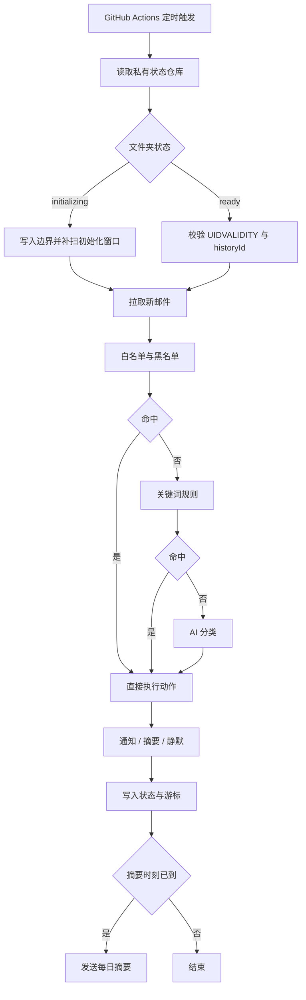

# MailPulse AI

An open-source, serverless AI email filter and notifier.

Automatically filter unwanted emails, prioritize what matters, and deliver intelligent notifications across your inboxes.

MailPulse AI 只处理新收到的邮件：首次运行记录每个邮箱当前的同步边界，此前的历史邮件不读取、不索引、不推送。系统按固定优先级判断每封新邮件，把重要邮件立即推送到 Telegram，把普通邮件留在每日摘要里，把广告邮件静默屏蔽。

## 功能

- 通用 IMAP 邮箱接入，支持多个邮箱同时检查
- Gmail API 接入
- 只处理新邮件，初始化与首次检查之间的邮件不会遗漏
- 发件人与域名黑白名单，命中后不调用 AI
- 主题与正文关键词过滤，白名单优先
- AI 自然语言规则分类，输出规则名称、类别、摘要与是否需要处理
- 广告邮件静默屏蔽，邮件原样保留在邮箱
- 重要邮件通过 Telegram 立即推送，附带可复制的屏蔽条目
- 普通邮件进入每日摘要，按配置时区定点发送
- 状态存放在私有仓库，仓库内只有邮件标识、分类结果、处理进度与通知结果

## 判定顺序

| 顺序 | 来源 | 命中后的动作 |
| --- | --- | --- |
| 1 | 白名单：发件人地址或域名 | 立即通知，不调用 AI |
| 2 | 黑名单：发件人地址或域名 | 静默屏蔽 |
| 3 | 关键词：主题或正文包含配置的词 | 静默屏蔽或进入摘要 |
| 4 | AI 规则：配置里的自然语言规则 | 该规则声明的动作 |
| 5 | AI 默认：未命中任何规则 | 促销类静默、重要类通知、普通类进入摘要 |

域名匹配包含子域名，地址匹配忽略大小写，关键词只做子串包含。

## 运行方式



## 部署

部署分两步：先建立公开代码仓库，再从它派生一份私有仓库用于实际运行。

### 一、部署到 GitHub Actions

1. 把本仓库放在公开的 GitHub 仓库里。公开仓库的 Actions 不计费。
2. 从本仓库创建一份私有仓库，用于实际运行，把 `config.yaml` 放进这份私有仓库。
3. 在私有仓库的 `Settings → Secrets and variables → Actions` 里添加以下机密：

| 机密名称 | 内容 |
| --- | --- |
| `MAIL_USER` | IMAP 登录名 |
| `MAIL_PASSWORD` | IMAP 密码或应用专用密码 |
| `AI_BASE_URL` | OpenAI 兼容接口的地址 |
| `AI_API_KEY` | 接口密钥 |
| `TELEGRAM_BOT_TOKEN` | Telegram Bot 的令牌 |
| `TELEGRAM_CHAT_ID` | Telegram 会话标识 |
| `STATE_GITHUB_TOKEN` | 有权读写状态仓库的个人访问令牌 |

4. 另外建一个私有的状态仓库，只用来存放 `mailpulse-state/state.json`。`STATE_GITHUB_TOKEN` 需要 `contents: write` 权限。
5. 在私有仓库的 `Actions` 页面手动触发一次 `mailpulse`，`mode` 选择 `init`，这一步只建立新邮件边界并补扫初始化窗口。
6. 之后定时任务每 15 分钟触发一次；代码内的 `sync.check_interval_minutes` 会再次把关实际检查间隔。

密钥与接口地址只存在于仓库机密里，`config.yaml` 里只写环境变量名。

### 二、本地运行

```bash
pip install -e .
export MAIL_USER=... MAIL_PASSWORD=... AI_BASE_URL=... AI_API_KEY=...
export TELEGRAM_BOT_TOKEN=... TELEGRAM_CHAT_ID=... STATE_GITHUB_TOKEN=...
mailpulse --config config.yaml validate
mailpulse --config config.yaml init
mailpulse --config config.yaml run
```

本地调试时可以把 `storage.backend` 改成 `local_file`，状态写入 `storage.local_path` 指向的文件。

## 配置说明

完整样例见 [config.example.yaml](config.example.yaml)。

### accounts

每个账户的 `connector` 决定接入方式：

- `imap`：需要 `host`、`port`、`username_env`、`password_env`，可选 `folder`、`use_ssl`、`tls_ca_file`。`tls_ca_file` 用于自建邮局的自签证书。
- `gmail`：需要 `client_id_env`、`client_secret_env`、`refresh_token_env`，可选 `query`。授权范围只需 `gmail.readonly`；开启 `sync.mark_as_read` 时需要 `gmail.modify`。

### filtering

- `default_block_action` 只接受 `mute`。删除邮件与自动移动垃圾箱在第一版不支持，写进配置会直接报错。
- `allowlist` 与 `blocklist` 分别接受 `senders` 与 `domains`，两者出现相同条目会在启动时报错。
- `keywords` 是规则列表，每条包含 `keywords` 与 `action`，动作只允许 `mute` 或 `digest`。
- `ai_rules` 是自然语言规则，动作只允许 `notify` 或 `mute`。

### digest

`enabled` 为真时需要开启 Telegram 推送，摘要在 `time` 时刻按 `timezone` 每天发送一次。

### storage

`backend` 取 `github_private_state` 时，`repo` 必填，`token_env` 指向存放令牌的环境变量。状态文件超过 1 MB 会直接报错，`ledger_retention_days` 控制保留天数。

## 实现要点

- 初始化分两步：先写入 `initializing` 与本地时间，再读取边界写入 `ready`。读取边界之前到达的邮件由“边界补扫”覆盖，读取之后到达的邮件由“主扫描”覆盖，两段按 UID 严格切分。
- 游标只推进到连续成功的前缀。任何一封邮件处理后失败，游标停在它之前，下一次重新拉取并重试，连续失败达到 `sync.max_attempts` 后标记为失败并越过。
- `UIDVALIDITY` 变化或 Gmail 返回游标过期时进入安全恢复：以当前最大 UID 建立新边界，同时用时间窗口补扫并按邮件标识去重，整个邮箱不会被当成新邮件重新推送。
- 通知采用至少一次投递：先发送成功再写入状态。进程在两步之间终止会重复推送一次，保证通知不丢失。
- 邮件正文按不可信输入处理，AI 输出只允许映射到配置里已存在的规则名，正文里出现的指令不会被执行。

## 测试

```bash
python -m pytest                 # 单元测试
python -m pytest -m integration  # 需要真实 IMAP、AI 与 Telegram 环境的集成测试
```

集成测试需要以下环境变量：

| 变量 | 说明 |
| --- | --- |
| `MAILPULSE_IT_IMAP_HOST` | 测试 IMAP 服务器地址 |
| `MAILPULSE_IT_IMAP_PORT` | 测试 IMAP 端口 |
| `MAILPULSE_IT_IMAP_CA` | 测试服务器证书路径 |
| `MAILPULSE_IT_IMAP_USER` | 测试账号 |
| `MAILPULSE_IT_IMAP_PASSWORD` | 测试密码 |
| `AI_BASE_URL` | OpenAI 兼容接口地址 |
| `AI_API_KEY` | 接口密钥 |

## 不包含的功能

删除邮件、自动移动到垃圾箱、历史邮件导入与索引、向量检索、Telegram 按钮回调、MCP Server。

## 许可

MIT
